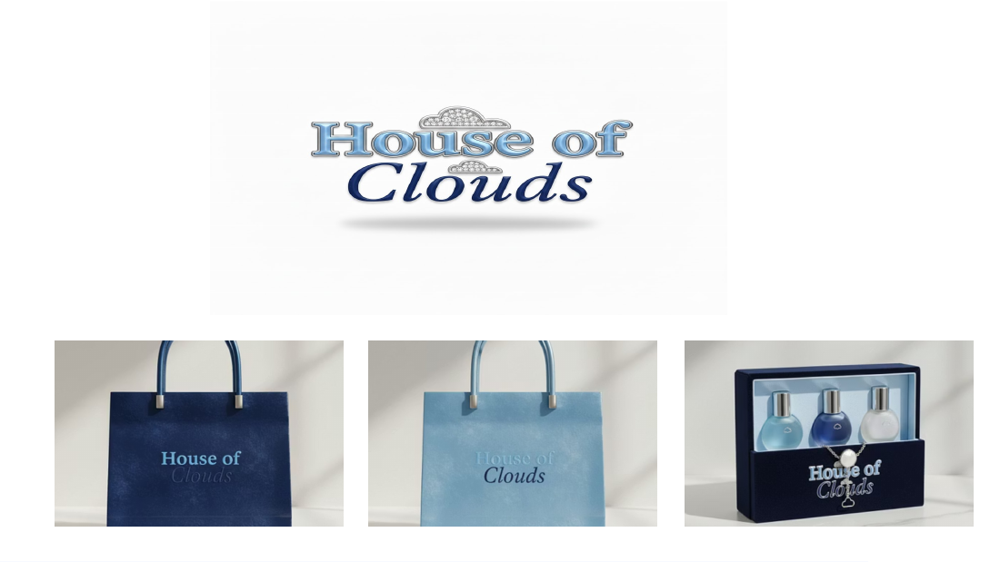
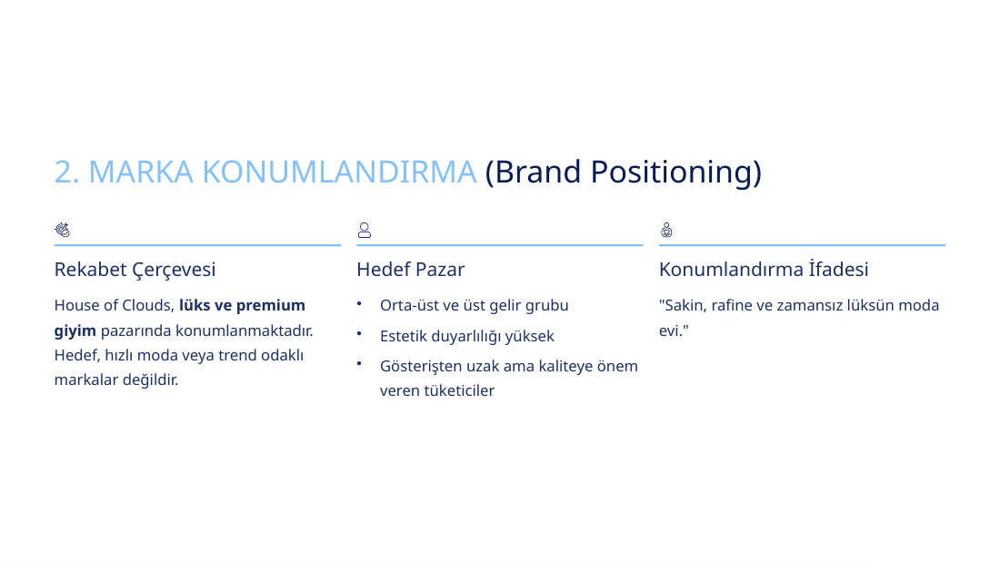
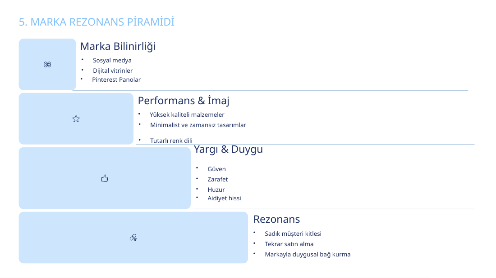
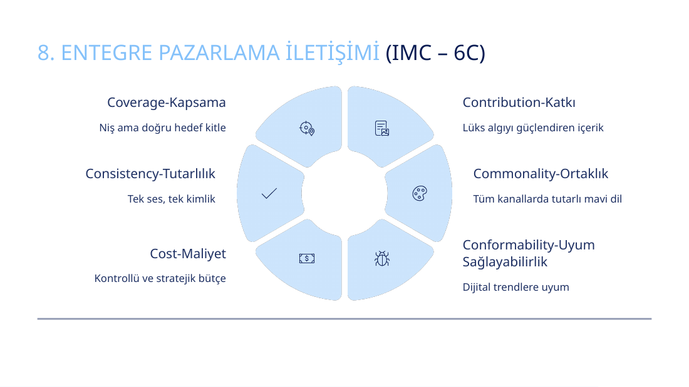

# House of Clouds | Brand Management Case Study

**House of Clouds** is a **fictional premium fashion-house concept** developed as an individual academic **Brand Management** project at **Gazi University, Management Information Systems**. The project explores how a consistent, emotionally meaningful brand identity can be built around **quiet luxury**, understated aesthetics, and a distinctive blue-only visual language.

> **Project type:** Academic brand strategy and identity concept — not an operating business, software product, or evidence of commercial sales.
>
> **Author:** Ece Temiz

## Project at a glance

| Dimension | Brand proposal |
| --- | --- |
| Brand | House of Clouds |
| Category | Premium / luxury fashion |
| Strategic position | Calm, refined, timeless luxury |
| Slogan | *Luxury in its calmest form.* |
| Brand mantra | *Calm – Blue – Luxury* |
| Target audience | Upper-middle/high-income consumers who value quality, aesthetics and understated design |
| Visual identity | Deep blue, soft blue and dusty blue; serif typography and cloud symbolism |
| Differentiation | Blue-only collections, calm emotional messaging, Pinterest-centered visual storytelling |

## Strategy and frameworks featured

1. **Brand elements:** name, logo, symbol, slogan, color palette, packaging and cloud motif.
2. **Brand positioning:** competitive frame, target audience and positioning statement.
3. **Points of Parity / Points of Difference:** premium-category conventions versus the proposed brand's distinctive traits.
4. **Dual positioning:** functional benefits (quality materials and timeless cuts) + emotional benefits (calm, serenity and sophistication).
5. **Brand resonance pyramid:** awareness, performance/image, consumer judgments/feelings and resonance, applied conceptually.
6. **Brand value chain:** proposed links from marketing investment to consumer mind-set, market outcomes and long-term brand value.
7. **Experiential marketing:** sensory, affective, behavioral and intellectual experiences, plus personalization.
8. **Integrated Marketing Communications (IMC / 6Cs):** coverage, contribution, commonality, conformability, cost and consistency.
9. **Secondary brand associations and brand extensions:** European aesthetic references, collaborations and potential product/category extensions.

These are **proposed strategic directions** in the course presentation, not measured market outcomes or implemented operations.

## Selected presentation previews

| Visual identity & packaging | Positioning |
| --- | --- |
|  |  |

| Brand resonance | Integrated marketing communications |
| --- | --- |
|  |  |

## View the full 13-slide presentation

- [Open presentation as PDF](presentation/House_of_Clouds_Brand_Management.pdf) — easy preview in GitHub
- [Download/edit PowerPoint](presentation/House_of_Clouds_Brand_Management.pptx) — editable source presentation

The GitHub-ready presentation has been edited only to remove a personal student number from the public-facing cover. The branding and academic content remain the same.

## Tools & skills

- **Microsoft PowerPoint:** presentation format and visual communication.
- **Brand management frameworks:** positioning, Points of Parity / Difference, brand resonance, brand value chain, IMC (6Cs), and brand extension planning.
- **Strategy and communication skills:** target audience definition, brand identity design, differentiated value proposition, experiential marketing, and cohesive messaging.

*The presentation does not establish use of a programming language or analytics platform. This repository intentionally contains no invented code or sales dataset.*

## Language

This project presentation is in Turkish. A [Turkish project overview](README_TR.md) is also available.

---
**Academic portfolio project** · Ece Temiz · Gazi University
